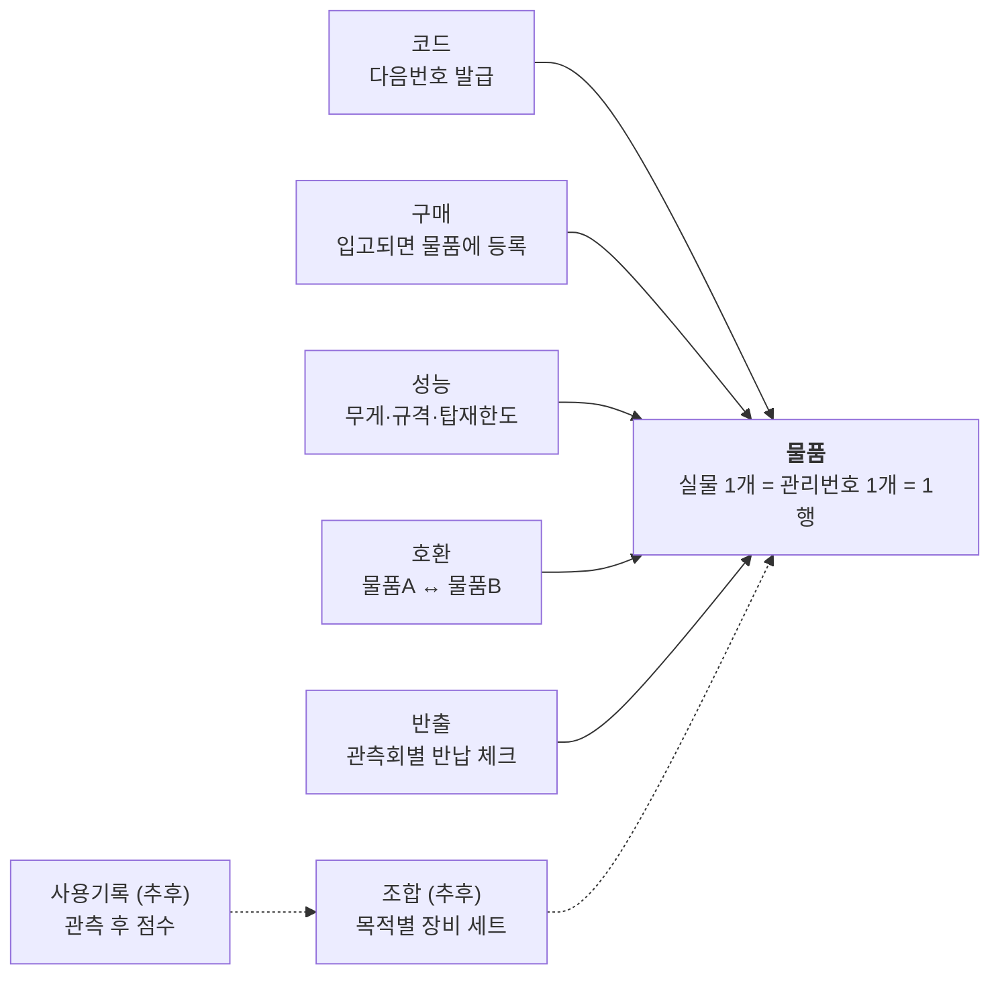

# 별바라기 장비실

- 조회 페이지: https://jiwon-astro.github.io/byeolbaragi-inventory/
- 원본(편집): [별바라기 물품대장 Google 시트](https://docs.google.com/spreadsheets/d/15LG_ahpBWunANCyk_0AsmTF4B6I2qQV2jct16SaYqW0/edit)

데이터는 Google 시트에서만 고칩니다. 이 페이지는 열 때마다 시트를 읽으므로 다시 배포할 필요가 없습니다.

---

# 관리 기준

## 한눈에 보기

실물 1개 = 관리번호 1개 = `물품` 시트 1행이고, 다른 모든 시트는 이 관리번호만 참조합니다. 기존 대장 파일 안에 아래 탭을 새로 만들고, 옛 탭은 이름 앞에 `(구)`를 붙여 보관합니다.

| 탭 | 1행 = | 언제 쓰나 | 단계 |
| --- | --- | --- | --- |
| 물품 | 실물 1개 | 입고·상태 변경·위치 변경 | 지금 |
| 성능 | 실물 1개 (관리번호당 1행) | 입고 시, 실측 후 | 지금 |
| 호환 | 물품 2개의 연결 1건 | 실제로 연결해 본 뒤 | 지금 |
| 반출 | 관측회 1회에 나간 실물 1개 | 관측회 전·후 | 지금 |
| 구매 | 사야 할 물품 1종 | 수시 | 지금 |
| 코드 | 분류 1개 | 분류 추가 시에만 | 지금 |
| 조합 | 장비 세트 1개 | 세트를 정할 때 | 추후 |
| 사용기록 | 관측 1회의 세트 사용 후기 | 관측 후 | 추후 |



화살표 = 관리번호로 참조, 점선 = 추후 추가. 어느 탭에서든 물품명을 직접 치지 않고 관리번호만 적으므로, 이름을 고칠 때는 `물품` 탭 한 곳만 고치면 됩니다.

원칙 세 가지:

1. **번호는 바꾸지도, 재사용하지도 않는다.** 분실·폐기돼도 행은 지우지 않고 상태만 바꾼다.
2. **물품명은 다른 시트에 다시 쓰지 않는다.** 관리번호만 쓰고 이름은 수식으로 불러온다.
3. **확인한 것만 적는다.** 모르는 값은 빈칸으로 두고 추정은 비고에 `(추정)`으로 적는다.

## 관리번호 체계

관리번호 = **분류코드 영문 2자 + 일련번호 2자리**(예: `MT01`, `EP12`)이며, 분류별로 01부터 순서대로 붙입니다. 99를 넘으면 `MT100`처럼 3자리로 이어갑니다. 현재 68개 물품에는 이미 이 규칙으로 번호가 붙어 있습니다.

### 분류코드표

| 코드 | 분류 | 포함 |
| --- | --- | --- |
| OT | 경통 | 굴절·반사 경통 |
| MT | 가대 | 적도의, 경위대, 트래커 |
| TP | 삼각대 | 삼각대, 피어 |
| BN | 쌍안경 | |
| EP | 접안렌즈 | |
| DG | 천정미러·프리즘 | 플립미러 포함 |
| CO | 보정렌즈 | 플래트너, 리듀서, 바로우 |
| FC | 포커서 | |
| GU | 파인더·가이드 | 파인더, 가이드스코프, 레드도트 |
| CA | 카메라 | DSLR, 천체카메라 |
| LE | 렌즈 | 카메라 렌즈 |
| FL | 필터 | 태양·협대역·광해 필터 |
| FW | 필터휠 | |
| AD | 어댑터 | T링, 스페이서, 도브테일, 규격 변환 |
| CT | 제어장치 | ASIAIR, 핸드컨트롤러, 노트북 |
| PW | 전원 | 배터리, 충전기, 어댑터 |
| CB | 케이블 | 전원·USB·제어 케이블 |
| CW | 웨이트 | 무게추, 무게추 봉 |
| BX | 보관함 | 박스, 가방, 케이스 |
| LT | 조명 | 후레시, 적색등 |
| ET | 기타 | 위에 없는 것 (콜리메이터, 공구 등) |

분류가 애매하면 **주된 용도** 하나로 정합니다. ET에 같은 종류가 5개 이상 쌓이면 코드를 새로 만들되, 기존 번호는 바꾸지 않습니다.

### 번호를 붙이는 대상

- **붙인다:** 따로 떼어 보관하거나 반출할 수 있는 것. 같은 모델이 3개면 번호도 3개.
- **붙인다:** 다른 물품에 붙어 있어도 분리할 수 있는 것(포커서, 파인더). `소속` 열에 붙어 있는 물품 번호를 적습니다.
- **붙인다:** 보관함. 상자 안 물품은 각자 번호를 받고 `위치`에 상자 번호를 적습니다.
- **안 붙인다:** 나사, 건전지 같은 소모품과 분리되지 않는 부품. 필요하면 본체 비고에 적습니다.

### 새 번호 발급

1. `코드` 탭에서 해당 분류의 **다음번호**를 확인합니다(자동 계산).
2. `물품` 탭 **맨 아래**에 행을 추가하고 그 번호를 적습니다.
3. 라벨을 본체와 케이스에 **둘 다** 붙입니다. 라벨에는 번호만 넣습니다(`MT01`).
4. 사진을 찍어 드라이브 사진 폴더에 `MT01.jpg`로 올립니다.

다음번호 수식(`코드` 탭 C열, A열 = 코드): 행을 지우지 않기 때문에 개수 + 1이 곧 다음 번호입니다.

```
=A2 & TEXT(COUNTIF('물품'!A:A, A2 & "*") + 1, "00")
```

## 시트별 작성 기준

모든 탭은 1행이 열 제목이고 2행부터 데이터입니다(제목 줄·설명 줄 없음). `(자동)` 열은 수식이라 입력하지 않습니다.

### 물품

| 열 | 입력 기준 |
| --- | --- |
| 관리번호 | `코드` 탭의 다음번호 |
| 분류 | (자동) 번호 앞 2자로 `코드` 탭에서 찾음 |
| 물품명 | 제조사 + 모델명 (예: Sky-Watcher AZ-GTi). 모르면 생김새 + `(모델 미확인)` |
| 상태 | 드롭다운 (아래 표) |
| 위치 | 평소 보관하는 자리. 상자 안이면 상자 번호 (`BX03`) |
| 소속 | 붙어 있는 본체 번호 (포커서 → `OT02`). 없으면 빈칸 |
| 최근점검일 | 실물을 직접 확인한 날 |
| 기존번호 | 옛 대장 번호 (`가-02`). 신규 물품은 빈칸 |
| 비고 | 고장 내용, 구성품, 주의사항 |

| 상태 | 뜻 |
| --- | --- |
| 정상 | 바로 쓸 수 있음 |
| 제한사용 | 쓸 수 있지만 조건이 있음. 조건은 비고에 |
| 수리필요 | 고치기 전엔 반출 금지 |
| 분실 | 찾지 못함. 찾으면 원래 상태로 |
| 폐기 | 버렸거나 내보냄. 행은 남김 |
| 미확인 | 실사 전 (이관한 68건의 초기값) |

### 성능

관리번호당 1행이며, 해당 없는 칸은 비웁니다. 호환과 무게 계산에 필요한 항목만 둡니다.

| 열 | 입력 기준 |
| --- | --- |
| 관리번호 / 물품명 | 번호만 입력, 물품명은 (자동) |
| 무게_kg | **실측** 무게. 경통은 밴드·도브테일 포함 |
| 구경_mm / 초점거리_mm | 경통·파인더·접안렌즈·카메라 렌즈 |
| 탑재한도_kg | 가대만. 제조사 공칭값 (실제 권장은 보통 그 60~70%) |
| 광학 규격 | 끼우는 쪽: 1.25", 2", M42(T2), M48, M54 등 |
| 장착 규격 | 가대·삼각대 연결: 도브테일 V/L, 1/4", 3/8" 등 |
| 전원 | 전압·커넥터 (12V 시가잭, 5.5/2.1mm 등) |
| 근거 | 실측 / 제조사 / 설명서 |
| 확인일 / 비고 | |

### 호환

**실제로 연결해 본 것만** 기록합니다. 규격만 보고 맞을 것 같다면 결과를 `미확인`으로 둡니다.

| 열 | 입력 기준 |
| --- | --- |
| 물품A / 물품B | 관리번호. 이름은 옆 열에 (자동) |
| 결과 | 가능 / 어댑터 필요 / 불가 / 미확인 |
| 어댑터 | 필요한 어댑터 관리번호 (여럿이면 쉼표) |
| 확인일 / 확인자 | |
| 비고 | 주의사항 ("초점 안 맞음, 연장통 필요") |

### 반출

관측회 1회에 나간 실물 1개당 1행입니다. 반납 체크박스가 비어 있는 행이 곧 아직 안 돌아온 물품입니다.

| 열 | 입력 기준 |
| --- | --- |
| 날짜 / 행사 | 관측회 날짜와 이름 (같은 행사는 같은 이름) |
| 관리번호 / 물품명 | 번호만 입력, 물품명은 (자동) |
| 담당자 | 그 물품을 책임지는 사람 |
| 반납 | 체크박스 |
| 비고 | 손상·누락 부품 |

### 구매

물품명 · 수량 · 예상단가 · 합계(자동) · 우선순위(높음/보통/낮음) · 상태(검토/승인/주문/입고) · 사유 · 링크. 입고되면 `물품` 탭에 번호를 발급하고 상태를 `입고`로 바꿉니다.

### 코드

코드 · 분류 · 다음번호(자동). 위 분류코드표 그대로입니다. 상태·결과 등의 드롭다운은 이 탭을 두지 않고 각 열의 데이터 확인 규칙으로 직접 걸어 둡니다.

## 운영 절차

분실은 대부분 반납 때 생기므로, **나간 번호 목록과 돌아온 번호를 대조**하는 것이 핵심입니다.

### 관측회 반출·반납

1. **반출 전:** 가져갈 물품 번호를 `반출` 탭에 한 줄씩 적고, 물품마다 담당자를 정합니다. 상태가 `수리필요`인 물품은 빼둡니다.
2. **포장:** 라벨을 보며 목록과 대조하고 담습니다. 작은 부품(접안렌즈, 어댑터)은 반드시 케이스에 넣습니다.
3. **현장 철수:** 담당자가 자기 번호를 챙깁니다. 다른 동아리 장비와 섞일 수 있으므로, 라벨이 없는 물건은 가져오지 않습니다.
4. **반납:** 장비실에서 `반출` 탭을 그 행사로 필터하고, 라벨을 보며 체크합니다. 손상은 비고에 적고 `물품` 탭 상태도 바꿉니다.
5. **미반납:** 체크되지 않은 행은 담당자에게 확인합니다. 1주일 안에 못 찾으면 `물품` 상태를 `분실`로 바꿉니다.

### 신규 입고

1. 번호 발급 → `물품` 행 추가 → 라벨 → 사진 (관리번호 체계의 새 번호 발급 참고).
2. `성능` 탭에 설명서 값을 넣고 근거를 `제조사`로 적습니다. 무게는 저울로 재서 `실측`으로 적습니다.
3. 구매한 물품이면 `구매` 탭 상태를 `입고`로 바꿉니다.

### 정기 실사 (학기 시작 · 종강)

1. `물품` 탭을 위치별로 정렬하고 선반부터 차례로 라벨을 확인합니다.
2. 확인한 물품은 최근점검일과 상태를 갱신합니다.
3. 최근점검일이 이번 실사보다 이전인 행 = 못 찾은 물품. 상태를 `분실`로 바꿉니다.
4. 라벨 없는 물건이 나오면 새 번호를 발급합니다.

### 분실·폐기

행을 지우지 않고 상태만 `분실`/`폐기`로 바꾼 뒤 비고에 날짜와 사유를 적습니다. 번호는 다른 물품에 다시 쓰지 않습니다.

## 추후 확장

확장은 새 탭 2개(`조합`, `사용기록`)만 추가하며, 지금 구조는 바꾸지 않습니다. 성능·호환 데이터가 쌓일수록 추천이 정확해지므로, 지금은 무게 실측과 호환 확인부터 채우는 것이 우선입니다.

### 호환 그래프

`호환` 탭이 곧 그래프 데이터입니다(물품 = 점, 호환 1행 = 선). 웹 페이지에 탭을 하나 더 만들어 이 탭을 그림으로 그리면 되고, 시트에 입력할 것은 늘어나지 않습니다. 선 색은 결과(가능 / 어댑터 필요 / 불가 / 미확인)로 구분합니다.

### 조합 (장비 세트)

| 열 | 입력 기준 |
| --- | --- |
| 조합번호 | `SET01`부터 |
| 조합명 | "교육용 도브소니안 세트" 등 |
| 목적 | 안시-교육 / 안시-딥스카이 / 촬영-일반 / 촬영-딥스카이 |
| 가대 / 삼각대 | 관리번호 |
| 탑재물 | 가대 위에 올라가는 것 (경통, 파인더, 카메라…), 쉼표로 구분 |
| 그 외 | 전원, 케이블, 웨이트 등 챙겨야 할 것 |
| 탑재무게_kg | (자동) 탑재물의 실측 무게 합 |
| 탑재한도_kg | (자동) 가대의 `성능` 값 |
| 하중비 | (자동) 탑재무게 ÷ 탑재한도 |
| 사용횟수 / 성공횟수 / 평균점수 | (자동) `사용기록`에서 집계 |

탑재무게 수식(탑재물이 F열, `성능` 탭 C열이 무게일 때):

```
=SUMPRODUCT(ISNUMBER(SEARCH('성능'!$A$2:$A$300, F2)) * '성능'!$C$2:$C$300)
```

### 사용기록

관측 후 세트마다 1행을 남기며, 점수는 1~5점입니다(5 = 가장 좋음).

날짜 · 조합번호 · 목적 · 기록자 · 설치시간_분 · 조작편의 · 안정성 · 운반편의 · 결과(성공/부분/실패) · 메모(대상, 날씨, 다음에 바꿀 점)

### 목적별 추천

`조합` 탭을 목적으로 필터하고 평균점수 순으로 정렬하면 추천 목록이 됩니다. 아래 세 가지를 모두 만족하는 조합만 **추천**으로 표시합니다.

- 같은 목적으로 **성공 2회 이상**
- 하중비 **0.7 이하**(촬영-딥스카이는 0.5 이하)
- 구성품 전부 `물품` 상태가 `정상` 또는 `제한사용`

목적별로 점수의 비중은 다릅니다. 교육용은 조작편의·설치시간을, 딥스카이 촬영은 안정성을 우선 봅니다. 다만 기록이 쌓이기 전에는 가중치를 정하지 않고 평균만 씁니다.

## 기존 대장에서 옮기는 방법

기존 68건은 이미 새 번호가 붙은 템플릿(`별바라기_물품관리.xlsx`)이 있으므로, 같은 파일에 탭으로 가져오고 실사로 확인만 하면 됩니다.

1. 기존 탭 이름 앞에 `(구)`를 붙입니다. 웹 페이지는 이름이 정확히 `물품` / `호환` / `구매`인 탭을 읽습니다.
2. **파일 → 가져오기 → 업로드**에서 xlsx를 올리고 **새 시트 삽입**을 고릅니다.
3. 실사에서 라벨을 붙이면서 `미확인` → 실제 상태로 바꾸고, 최근점검일을 적습니다. `기존번호` 열로 옛 라벨과 대조합니다.
4. 물품명이 `사진첨부`인 4건(MT04, TP05~07)은 실물을 보고 이름을 다시 적습니다.
5. 옛 대장에만 있는 물품(상자 내용물, 과거 목록)은 실물을 찾았을 때만 새 번호를 발급합니다.
6. 한 학기 동안 문제가 없으면 `(구)` 탭을 숨깁니다(삭제하지 않음).

---

# 유지보수

### 시트 (평소)

- 탭 이름 `물품` / `호환` / `구매`는 바꾸지 않습니다(웹 페이지가 이 이름으로 읽음).
- 1행은 열 제목. 그 위에 제목·설명 줄을 넣지 않습니다.
- `물품` 탭의 A열(관리번호)과 C열(물품명) 위치는 옮기지 않습니다(다른 탭 수식이 참조).
- 열 추가는 맨 오른쪽에. 웹 페이지에도 자동으로 나타납니다.
- 드롭다운 값 변경: 열 선택 → **데이터 → 데이터 확인**.
- 300행을 넘으면 자동 수식 열(물품명, 분류, 합계)의 마지막 칸을 아래로 끌어 늘립니다.
- 시트 공유는 "링크가 있는 모든 사용자 - 뷰어"를 유지해야 웹 페이지가 읽을 수 있습니다.

### 웹 페이지 (드묾)

GitHub에서 `index.html` → 연필(Edit) → 수정 → **Commit changes**. 1~2분 뒤 반영됩니다.

- 다른 시트 연결: `const SHEET_ID = '...'` 줄의 ID만 바꿉니다.
- 탭 추가(예: 성능): `구매 필요` 버튼 아래에 한 줄 추가.

  ```html
  <button role="tab" data-sheet="성능">성능</button>
  ```

### 백업·인계

- 시트는 **파일 → 버전 기록**으로 되돌릴 수 있습니다. 학기 말에 xlsx로 한 부 내려받아 둡니다.
- 인계 시 시트 편집 권한을 주고, 이 저장소는 **Settings → Collaborators**에 추가합니다. 동아리 계정으로 옮기려면 **Settings → Transfer**(사이트 주소가 바뀜).
